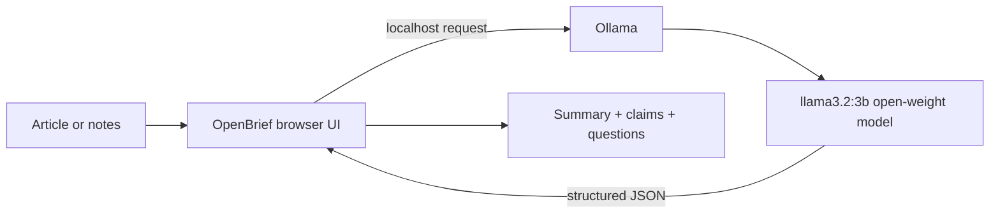

# OpenBrief

> Read less. Understand more.

OpenBrief is a local-first reading desk that turns a dense article, research abstract, or meeting note into a concise brief: a plain-English summary, claims worth checking, and questions to carry forward.

## Why this project

Closed AI tools make it easy to paste sensitive reading into a remote service and receive an answer that sounds confident. OpenBrief makes the trade-off visible: use an open-weight model locally, inspect the output, and keep the original text on your machine.

## How to run the real AI mode

1. Install [Ollama](https://ollama.com/).
2. Download the open-weight model:

   ```bash
   ollama run llama3.2:3b
   ```

3. Serve this directory with any static server, for example:

   ```bash
   python -m http.server 8000
   ```

4. Open `http://localhost:8000`, paste 20+ words, and choose **Build my brief**.

The browser calls Ollama at `http://localhost:11434/api/generate`. The model is instructed to return structured JSON with exactly three claims and three questions. No API key or account is required.

## Demo mode

If Ollama is unavailable, OpenBrief displays a clearly labeled deterministic demo result. This keeps the interface testable without pretending that the result came from an AI model. The real submission path is Ollama + `llama3.2:3b`.

## Architecture



## Technical decisions

- **Static HTML/CSS/JavaScript:** easy to inspect, deploy, and run without a build step.
- **Ollama:** local inference keeps source text private and makes the open-source AI choice explicit.
- **Structured JSON:** predictable rendering is safer than parsing free-form model output.
- **Demo fallback:** transparent degraded behavior is better than a broken screen or a fake “AI” result.

## Limitations

- The browser needs Ollama's local API for real inference.
- The model can still produce incorrect summaries; claims are prompts for verification, not citations.
- This MVP does not store documents, which is intentional for privacy.

## Attribution and license

OpenBrief is original work for the Hacktoberfest 2026 Weekend Challenge. It uses [Ollama](https://ollama.com/) and the [Llama 3.2 model family](https://www.llama.com/llama-downloads/). See [LICENSE](LICENSE).
