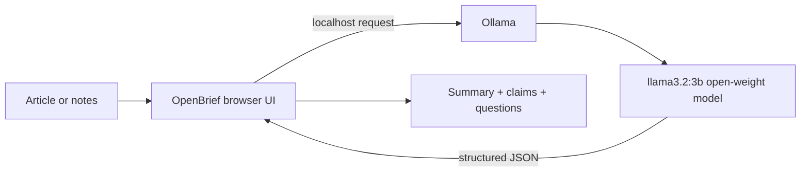

# OpenBrief: Read less. Understand more.

Dense reading should not require sending private notes to a hosted AI service. OpenBrief is a local-first reading desk that turns an article, research abstract, or meeting note into three useful outputs: a plain-English summary, claims worth checking, and questions to carry forward.

## Try it

- Repository: **TODO: add the public repository URL**
- Demo: **TODO: add the deployed demo URL**
- Local setup: see the [README](./README.md)

## Why open-source AI matters

OpenBrief uses Ollama with the open-weight `llama3.2:3b` model. The browser sends the pasted text to the user's local Ollama service rather than a hosted API. That means the reader can inspect the model choice, run without an account or API key, and keep sensitive reading on their machine.

## How it works

1. Paste at least 20 words.
2. OpenBrief requests structured JSON from the local model.
3. The interface renders a summary, three verification prompts, and three follow-up questions.
4. If Ollama is unavailable, the app clearly labels a deterministic demo result instead of pretending it is AI-generated.

## What I built

- A responsive, dependency-free web interface.
- A local inference path using Ollama's `/api/generate` endpoint.
- Structured JSON output for predictable rendering.
- A transparent offline/demo fallback.
- Copy-to-clipboard for sharing a brief.
- Privacy-first behavior: no accounts, database, analytics, or document storage.

## What I learned

The most important product decision was not adding more AI features. It was making the boundary visible: real local inference when Ollama is connected, and an explicitly labeled fallback when it is not. That keeps the demo reliable without misleading the reader about where an answer came from.

## Limitations and next steps

The model can still make mistakes, so the “claims to check” are prompts for verification, not citations. The next version could add source-linked citations, model health diagnostics, and an optional browser-based open model for people who cannot install Ollama.

## Credits and license

OpenBrief is original work created during the Hacktoberfest 2026 Weekend Challenge. It uses [Ollama](https://ollama.com/) and the [Llama 3.2 model family](https://www.llama.com/llama-downloads/), and is released under the MIT License.

## AI disclosure

AI tools assisted with implementation and editing. I reviewed the generated code, tested the interaction, and remain responsible for the final project and article.

## Team

Solo project. **TODO: list teammate DEV handles if applicable.**
